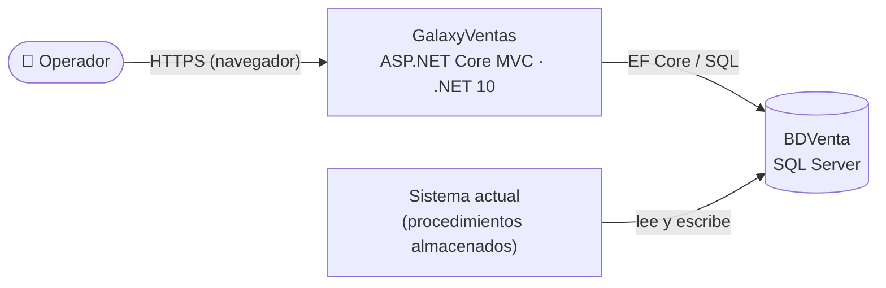
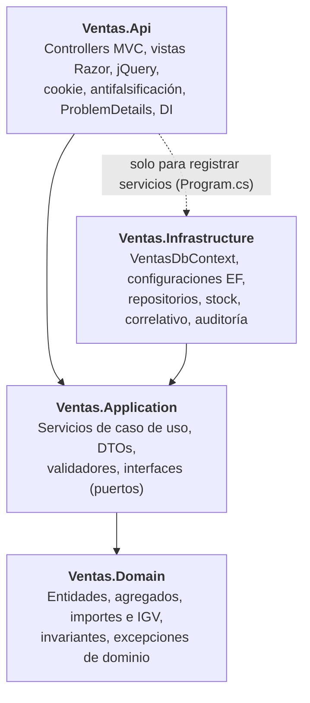
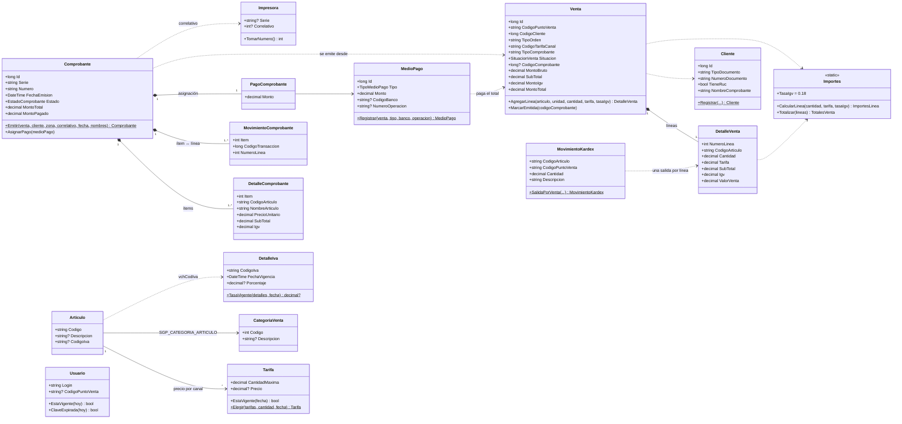
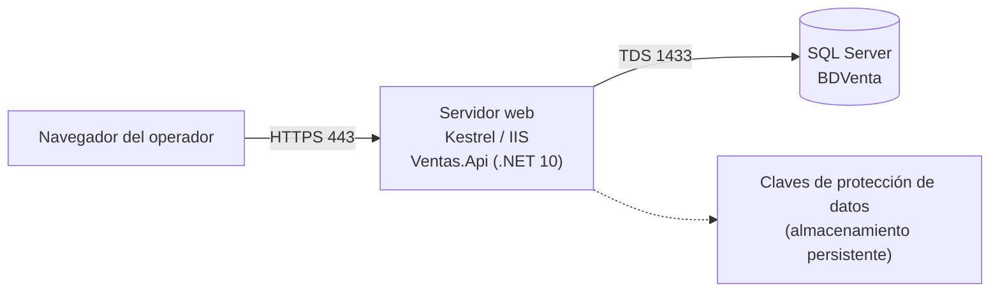

# Documento de arquitectura — GalaxyVentas

| | |
|---|---|
| **Dirigido a** | Desarrolladores, revisores técnicos y evaluadores del proyecto |
| **Versión** | 1.0 — 30/10/2026 |
| **Relacionado** | [Requerimientos funcionales](requerimientos-funcionales.md) · [Casos de uso](casos-de-uso.md) · [Plan de pruebas](plan-de-pruebas.md) |

## 1. Contexto y restricciones

GalaxyVentas es una aplicación web MVC para el operador de un punto de venta. Reemplaza la captura de ventas del sistema actual, pero **comparte su base de datos** (`BDVenta`, SQL Server), por lo que la arquitectura está condicionada por tres restricciones:

| Restricción | Consecuencia en el diseño |
|---|---|
| El esquema de `BDVenta` no se puede modificar (RNF-01). Tiene nombres en notación húngara (`SGP_*`, `vch*`, `num*`), flags `'S'/'N'`, códigos con espacios a la izquierda y tipos incoherentes entre columnas relacionadas. | Todo el conocimiento del esquema heredado vive **solo en Infrastructure** (configuraciones EF y conversores). El resto del código usa nombres limpios y tipos correctos. |
| Los datos deben grabarse igual que los procedimientos almacenados del sistema actual (`StoreProcedure.sql`). | Los valores fijos y formatos de los procedimientos se replican en el dominio y en el mapeo, y se verifican con pruebas contra la BD real. |
| Venta, comprobante, kardex y pago deben grabarse en una sola transacción (RN-15), con concurrencia segura sobre stock y correlativo. | Unidad de trabajo con transacción explícita, `sp_getapplock` por artículo y `UPDLOCK` sobre la impresora. |



## 2. Vista lógica: Clean Architecture

La solución tiene cuatro proyectos en `src/`. Las dependencias apuntan hacia el dominio y están impuestas por las referencias entre proyectos:



| Capa | Contiene | No contiene |
|---|---|---|
| **Domain** | `Venta`, `Comprobante`, `MedioPago`, `Cliente`, `Tarifa`, `DetalleIva`…; cálculo de importes (`Importes`), elección de tarifa (`Tarifa.Elegir`), tasa de IVA vigente (`DetalleIva.TasaVigente`), numeración (`TiposComprobante`, `Impresora.TomarNumero`). | EF, SQL, HTTP, DTOs, nombres de columnas. |
| **Application** | `VentaService`, `RegistroVentaService`, `ArticuloService`, `ClienteService`, `CatalogoService`, `ConsultaVentasService`, `ReporteVentasService`, `AutenticacionService`, `MisDatosService`; validadores FluentValidation; interfaces `IVentaRepository`, `IStockService`, `ICorrelativoService`, `IUnitOfWork`, `IUsuarioActual`… | EF Core, `HttpContext`, cookies. |
| **Infrastructure** | `VentasDbContext`, una `IEntityTypeConfiguration<T>` por tabla, conversores (`Conversiones`), interceptores (`AuditoriaInterceptor`, `ValoresHeredadosInterceptor`), repositorios, `StockService`, `CorrelativoService`, `UnidadTrabajo`, `VerificadorClave`. | Reglas de negocio. |
| **Ventas.Api** | Controllers delgados, vistas Razor y view models, `wwwroot/js`, `UsuarioActual` (lee los claims), `ManejadorExcepciones`, composición de DI. | Lógica de negocio, entidades de EF en vistas o respuestas JSON. |

### Principios aplicados

1. **Regla de dependencia:** Domain no conoce la base de datos ni HTTP; Application no conoce EF Core.
2. **Inversión de dependencias:** Application declara interfaces (puertos) y Infrastructure o la capa web las implementan; la DI inyecta la implementación en ejecución.
3. **Esquema heredado encapsulado:** `SGP_*`, `vch*`, `'S'/'N'`, `' 001'`, `' 30'` solo aparecen en las configuraciones EF.
4. **Reglas en el dominio:** totales, IGV e invariantes son métodos de las entidades, probados sin base de datos ni mocks. Application orquesta: carga, valida, llama al dominio y persiste.

## 3. Vista de componentes por funcionalidad

| Funcionalidad | Web (`Ventas.Api`) | Application | Infrastructure |
|---|---|---|---|
| Inicio de sesión | `CuentaController`, `UsuarioActual`, `ClaimsSesion` | `AutenticacionService` | `UsuarioRepository`, `VerificadorClave` |
| Artículos | `ArticulosController` (JSON) | `ArticuloService` | `ArticuloRepository`, `StockService` |
| Clientes | `ClientesController` (JSON) | `ClienteService`, `RegistrarClienteValidator` | `ClienteRepository` |
| Catálogos | `CatalogosController` (JSON) | `CatalogoService` | `CatalogoRepository` |
| Venta | `VentasController` (vista), `VentasApiController` (JSON: `Cotizar`, `Registrar`, `SiguienteNumero`) | `VentaService`, `RegistroVentaService`, validadores | `VentaRepository`, `ComprobanteRepository`, `KardexRepository`, `CorrelativoService`, `UnidadTrabajo` |
| Consultas y comprobante | `ConsultasController`, `ComprobantesController` | `ConsultaVentasService` | `ConsultaVentasRepository` |
| Reporte | `ReportesController` | `ReporteVentasService` | `ConsultaVentasRepository` |
| Mis datos | `MisDatosController` | `MisDatosService`, `CambiarClaveValidator` | `UsuarioRepository`, `VerificadorClave` (`ICambioClave`) |

Organización interna: carpetas por funcionalidad en cada capa (`Ventas/`, `Comprobantes/`, `Pagos/`, `Maestros/`, `Seguridad/`, `Reportes/`). Cada capa expone su registro de DI: `AddWeb()`, `AddApplication()`, `AddInfrastructure(configuration)`.

## 4. Vista de procesos: registrar una venta

La pantalla no calcula importes: los pide a `POST /Ventas/Cotizar`, que usa las mismas reglas del dominio que el registro. Al confirmar, `POST /Ventas/Registrar` graba todo en una transacción.

```mermaid
sequenceDiagram
    autonumber
    actor Op as Operador
    participant JS as registrar-venta.js
    participant C as VentasApiController
    participant S as RegistroVentaService
    participant V as Validador (FluentValidation)
    participant UoW as IUnitOfWork
    participant St as IStockService
    participant Art as IArticuloRepository
    participant Cor as ICorrelativoService
    participant D as Domain (Venta, Comprobante, MedioPago, MovimientoKardex)
    participant BD as BDVenta

    Op->>JS: Registrar venta
    JS->>C: POST /Ventas/Registrar (JSON + token antifalsificación + cookie)
    C->>S: RegistrarAsync(dto)
    S->>V: ValidateAndThrowAsync(dto)
    Note over S: Usuario y punto de venta desde IUsuarioActual (claims)<br/>Cliente, tipo de orden V41, almacén, zona
    S->>UoW: EjecutarEnTransaccionAsync(...)
    UoW->>BD: BEGIN TRANSACTION
    S->>St: BloquearAsync(punto de venta, artículos)
    St->>BD: sp_getapplock por artículo + punto de venta
    S->>Art: ObtenerConTarifasVigentesAsync(V41, 30, artículos)
    S->>St: ObtenerStockAsync(...)
    S->>Cor: ObtenerParaEmitirAsync(serie)
    Cor->>BD: SELECT SGP_IMPRESORA WITH (UPDLOCK)
    S->>D: new Venta(...) + AgregarLinea(cantidad, tarifa, tasa IGV)
    Note over D: Calcula valor venta, IGV y totales<br/>Valida stock, tarifa e invariantes
    S->>UoW: GuardarCambiosAsync (1)
    UoW->>BD: INSERT cabecera ('I') + detalle → numCodTransaccion
    S->>D: Comprobante.Emitir(venta, cliente, impresora.TomarNumero())
    S->>D: MedioPago.Registrar(venta, ...) + comprobante.AsignarPago(...)
    S->>D: MovimientoKardex.SalidaPorVenta(...) por línea
    S->>UoW: GuardarCambiosAsync (2)
    UoW->>BD: INSERT comprobante, detalle, movimientos, pago, kardex; UPDATE impresora
    S->>D: venta.MarcarEmitida(codigoComprobante)
    S->>UoW: GuardarCambiosAsync (3)
    UoW->>BD: UPDATE cabecera → 'A' + numCodComprobante
    UoW->>BD: COMMIT (o ROLLBACK ante cualquier excepción)
    S-->>C: VentaRegistradaDto
    C-->>JS: 201 Created + URL del comprobante
    JS->>Op: Abre /Comprobantes/Ver/{id}?nuevo=true
```

**Puntos clave**

- **Tres `SaveChanges`** dentro de la misma transacción: el primero obtiene `numCodTransaccion` (IDENTITY), que necesitan el comprobante y el kardex; el último deja la cabecera en `'A'`, igual que el procedimiento de referencia.
- **Concurrencia de stock:** el kardex no tiene índices ni tabla de saldos; bloquear filas no evitaría que dos ventas leyeran el mismo saldo. Por eso se toma un bloqueo de aplicación (`sp_getapplock`) por artículo y punto de venta, en orden, antes de leer el stock. Se libera con la transacción.
- **Correlativo:** `UPDLOCK` sobre la impresora de la serie; dos ventas simultáneas nunca obtienen el mismo número y, si la venta falla, el correlativo no avanza.
- **Auditoría y valores heredados:** `AuditoriaInterceptor` rellena `vchCreador`/`dtmFechaCreacion` (o `vchModificador`/`dtmFechaModificacion`) con el usuario de la sesión; `ValoresHeredadosInterceptor` rellena las columnas con valor fijo declaradas con `.ValorAlInsertar(...)`.
- **Errores:** cualquier excepción deshace la transacción. `ManejadorExcepciones` la traduce a ProblemDetails (RFC 7807).

### Flujo de errores

| Excepción | Origen típico | AJAX (ProblemDetails) | Página |
|---|---|---|---|
| `ValidationException` | Validadores FluentValidation | 400 con errores por campo | Errores en el mismo formulario |
| — | Token antifalsificación ausente o inválido | 400 | 400 |
| `NoAutenticadoException` / sin cookie | Sesión expirada o usuario no vigente | 401 | Redirección a `/Cuenta/IniciarSesion` |
| `AccesoDenegadoException` | Recurso de otro punto de venta | 403 | Vista de error con el motivo |
| `NoEncontradoException` | Venta, comprobante, cliente o artículo inexistente | 404 | Vista de error con el motivo |
| `ConflictoException` | Cliente duplicado, stock bloqueado por otra venta | 409 | Vista de error con el motivo |
| `DominioException` | Stock insuficiente, sin tarifa, factura sin RUC | 422 | Vista de error con el motivo |
| Otra | Error inesperado | 500 sin detalle interno | Vista de error genérica |

## 5. Modelo de dominio

### 5.1 Diagrama de clases



### 5.2 Agregados e invariantes

| Agregado (raíz) | Invariantes que protege |
|---|---|
| **Venta** | Al menos una línea para emitirse; cantidad > 0; tarifa ≥ 0; un artículo no se repite; los totales son siempre la suma exacta de las líneas; no se agregan líneas una vez emitida; solo se emite una vez. |
| **Comprobante** | Se emite desde una venta con líneas y con el mismo cliente; la factura exige RUC; un ítem y un movimiento por línea; un único pago, por el total exacto; al pagarse queda cancelado. |
| **MedioPago** | Monto = total de la venta; cheque, tarjeta y depósito exigen banco y número de operación; solo medios admitidos (1 a 5). |
| **Impresora** | Toma el correlativo guardado (o 1) y deja el siguiente; inactiva no emite. |
| **Cliente** | DNI de 8 dígitos o RUC de 11; persona deducida del documento; jurídica exige razón social; RUC exige dirección. |

### 5.3 Cálculo de importes

La tarifa incluye el IGV (P-15). Por línea: `SubTotal = Cantidad × Tarifa`; `ValorVenta = round(SubTotal / (1 + tasa), 4)`; `IGV = SubTotal − ValorVenta`. La tasa es la del código de IVA del artículo en `SGP_DETALLE_IVA` (vigencia más reciente; `E20` = 0 %, `G01` = 18 %). Cabecera: `MontoBruto = Σ SubTotal`, `SubTotal = Σ ValorVenta`, `MontoIgv = Σ IGV`, `MontoTotal = SubTotal + MontoIgv`. Todo con 4 decimales; la presentación redondea a 2.

## 6. Vista de datos: mapeo al esquema heredado

| Entidad | Tabla | Particularidades del mapeo |
|---|---|---|
| `Venta` / `DetalleVenta` | `SGP_CABECERA_TRANSACCION_BS` / `SGP_DETALLE_TRANSACCION_BS` | `numCodCliente` `int` ↔ `long`; canal `'30'` ↔ `' 30'` (`CanalCabecera`); `numCodComprobante` es `numeric(9,4)` (máximo 99 999, P-12). |
| `Comprobante` / `DetalleComprobante` / `MovimientoComprobante` | `SGP_COMPROBANTE_BS` / `SGP_DETALLE_COMPROBANTE_BS` / `SGP_MOVIMIENTO_TRANSACCION_BS` | `vchEstado = '2'`, `chrFlagFacturado` y `vchFlagMedioPago` con `FlagSN`. |
| `MedioPago` / `PagoComprobante` | `SGP_MEDIO_PAGO_BS` / `SGP_MEDIO_PAGO_COMPROBANTE_BS` | `vchOrigen = 'PGA'`, `numLinea = 0` como valores al insertar. |
| `MovimientoKardex` | `PGA_TRANSACCION_KARDEX` | Columnas sin notación húngara; punto de venta `' 001'`. |
| `Articulo`, `Tarifa`, `CategoriaVenta`, `CategoriaArticulo`, `DetalleIva` | `SGP_ARTICULO`, `SGP_TARIFA`, `SGP_CATEGORIA_VENTA`, `SGP_CATEGORIA_ARTICULO`, `SGP_DETALLE_IVA` | `SGP_TARIFA` en `nvarchar` con espacios a la izquierda; estado de categorías en `vchestado`; los códigos se comparan con `Trim()`. |
| `Usuario` | `SGP_USUARIO` | Contraseña como propiedad de sombra `Clave`, leída y cambiada solo por `VerificadorClave`. |

Convenciones transversales: borrado lógico con `chrSituacionRegistro` (`'A'` = activo) expuesto como `Activo` desde el campo `bool? _activo`; auditoría como propiedades de sombra (`MapearAuditoriaSgp()` / `MapearAuditoriaPga()`); no se usan migraciones de EF Core.

## 7. Seguridad

| Aspecto | Implementación |
|---|---|
| Autenticación | Cookie `GalaxyVentas.Sesion`: `HttpOnly`, `Secure`, `SameSite=Strict`, 8 horas sin renovación. Claims: login, nombre y punto de venta; nunca la contraseña. |
| Revalidación | En cada petición se comprueba que el usuario siga activo, vigente y con el mismo punto de venta (`OnValidatePrincipal`). |
| Autorización | Política por defecto que exige sesión; solo el inicio de sesión, la página de error y los archivos estáticos son anónimos. Sin sesión: página → redirección; AJAX → 401. |
| Antifalsificación | `AutoValidateAntiforgeryToken` global; los formularios usan el token de Razor y jQuery lo envía en la cabecera `RequestVerificationToken`. |
| Aislamiento por punto de venta | El punto de venta se toma siempre de los claims (`IUsuarioActual`), nunca de la petición; recursos de otro punto de venta → 403. |
| Contraseñas | Comparación exacta en tiempo constante (`CryptographicOperations.FixedTimeEquals`); mensaje genérico ante credenciales incorrectas; nunca en logs ni respuestas. Se guardan en texto plano por compatibilidad con el sistema actual (P-02, riesgo aceptado). |
| Secretos | Cadena de conexión en User Secrets / variables de entorno, nunca en el repositorio. |
| Transporte | HTTPS obligatorio (`UseHttpsRedirection`, HSTS fuera de desarrollo). |

## 8. Decisiones de arquitectura

| # | Decisión | Motivo | Alternativa descartada |
|---|---|---|---|
| D-01 | MVC con vistas Razor + jQuery, acciones JSON solo donde la pantalla es interactiva (venta). | Requisito del proyecto; páginas de consulta y reporte sin JavaScript. | SPA con API REST pura. |
| D-02 | Clean Architecture en cuatro proyectos. | Aislar el esquema heredado y probar las reglas sin BD. | Capas en un solo proyecto. |
| D-03 | Reproducir en C# lo que hacen los procedimientos almacenados, sin invocarlos. | Los procedimientos no abren transacción ni manejan concurrencia; tienen errores conocidos (kardex con canal NULL). | Llamar a los procedimientos. |
| D-04 | Importes calculados solo en el servidor (`/Ventas/Cotizar`). | Una sola implementación de las reglas; la pantalla no puede alterar montos. | Cálculo en JavaScript. |
| D-05 | `sp_getapplock` por artículo + punto de venta para el stock. | El kardex no tiene índices ni saldos; bloquear filas no es suficiente. | Aislamiento serializable. |
| D-06 | Tipo de orden `V41` y canal `30` fijos. | Son los únicos con categorías de artículo y tarifas vigentes (RF-01). | Canal y tipo de orden por artículo. |
| D-07 | IGV por artículo desde `SGP_DETALLE_IVA`. | Hay artículos exonerados (libros). | Tasa fija 0.18. |
| D-08 | Contraseña en texto plano. | El sistema actual valida contra la misma columna. | Hash (rompería el sistema actual). |

## 9. Despliegue



Requisitos para producción:

- Cadena de conexión por variable de entorno `ConnectionStrings__DefaultConnection`.
- Claves de protección de datos (firman la cookie y el token antifalsificación) persistidas fuera del repositorio; sin ellas, cada reinicio cierra las sesiones.
- Certificado HTTPS válido.
- Usuario de BD con permisos de lectura y escritura sobre las tablas usadas y permiso para `sp_getapplock`; no requiere permisos de DDL.

## 10. Riesgos y deuda técnica

| Riesgo | Impacto | Mitigación / estado |
|---|---|---|
| Contraseñas en texto plano (P-02). | Exposición de credenciales si se filtra la BD. | Cifrar cuando el sistema actual deje de usar `SGP_USUARIO`. |
| `numCodComprobante` de la cabecera es `numeric(9,4)` (P-12). | Ventas con comprobante > 99 999 no se pueden enlazar. | El servicio lo detecta y rechaza la venta; requiere decisión sobre el esquema. |
| Decisiones pendientes P-11, P-21, P-22. | Redondeo de presentación, pago mixto y valores heredados. | Documentadas en los requerimientos. |
| Paquetes NuGet con vulnerabilidades conocidas (`Microsoft.OpenApi` 2.0.0, `System.Security.Cryptography.Pkcs` 9.0.11). | Avisos de seguridad en la compilación. | Actualizar a versiones corregidas. |
| Datos de prueba en la BD (categorías V41/30 y stock de carga inicial). | Stock no real. | Reversibles con los bloques comentados de los scripts. |
