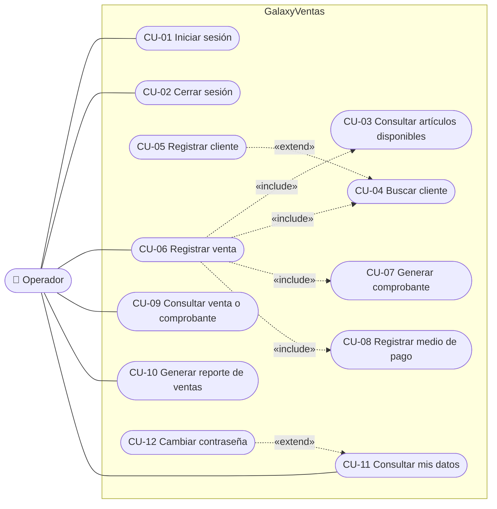

# Casos de uso — Sistema de Ventas de Punto de Venta

| | |
|---|---|
| **Proyecto** | GalaxyVentas — Sistema de ventas de artículos para punto de venta |
| **Versión** | 1.0 |
| **Fecha** | 30/10/2026 |
| **Base** | [Requerimientos funcionales](requerimientos-funcionales.md) v0.6 (RF, RN y supuestos P-xx) |

Este documento describe cómo el operador usa el sistema para cumplir cada objetivo. Las reglas de detalle (cálculos, valores que se graban, códigos de error) están en los requerimientos funcionales; aquí se referencian por su código.

---

## 1. Actores

| Actor | Tipo | Descripción |
|---|---|---|
| **Operador** (vendedor / cajero) | Principal | Usuario registrado en `SGP_USUARIO` y asignado a un punto de venta. Inicia sesión, atiende al cliente, registra la venta y el cobro, consulta ventas y comprobantes, obtiene el reporte y administra su contraseña. |
| **Base de datos `BDVenta`** | Secundario (sistema) | Fuente de los maestros (artículos, tarifas, clientes, catálogos, impresoras) y destino de la venta, el comprobante, el pago y el kardex. |

La gestión de usuarios, maestros y la anulación de comprobantes están fuera de alcance (sección 8 de los requerimientos).

## 2. Diagrama de casos de uso

Todos los casos de uso, salvo CU-01, requieren una sesión válida (RF-19).

## 3. Resumen

| ID | Caso de uso | Requerimientos | Pantalla |
|---|---|---|---|
| CU-01 | Iniciar sesión | RF-21, RF-19 | `/Cuenta/IniciarSesion` |
| CU-02 | Cerrar sesión | RF-21 | Menú lateral |
| CU-03 | Consultar artículos disponibles | RF-01 | `/Ventas/Registrar` — sección 2 |
| CU-04 | Buscar cliente | RF-02 | `/Ventas/Registrar` — sección 1 |
| CU-05 | Registrar cliente | RF-03 | `/Ventas/Registrar` — sección 1 |
| CU-06 | Registrar venta | RF-05 a RF-09, RF-15 | `/Ventas/Registrar` |
| CU-07 | Generar comprobante | RF-10 a RF-12 | `/Comprobantes/Ver/{id}` |
| CU-08 | Registrar medio de pago | RF-13, RF-14 | `/Ventas/Registrar` — sección 5 |
| CU-09 | Consultar venta o comprobante | RF-16, RF-17 | `/Consultas` |
| CU-10 | Generar reporte de ventas | RF-22 | `/Reportes/Ventas` |
| CU-11 | Consultar mis datos | — | `/MisDatos` |
| CU-12 | Cambiar contraseña | — | `/MisDatos` |

---

## 4. Especificación de los casos de uso

### CU-01 — Iniciar sesión

| | |
|---|---|
| **Actor** | Operador |
| **Objetivo** | Identificarse para usar el sistema en su punto de venta. |
| **Precondiciones** | El operador está registrado en `SGP_USUARIO`. |
| **Disparador** | El operador abre el sistema o intenta entrar a una página sin sesión. |
| **Requerimientos** | RF-21, RF-19 · RN-18, RN-19 |

**Flujo principal**

1. El sistema muestra el formulario de inicio de sesión.
2. El operador ingresa su usuario y contraseña y confirma.
3. El sistema verifica que el usuario exista, esté activo y vigente, que la contraseña coincida (distingue mayúsculas) y que tenga un punto de venta asignado.
4. El sistema inicia la sesión (cookie segura válida por 8 horas con login, nombre y punto de venta; nunca la contraseña).
5. El sistema muestra la pantalla *Registrar venta*, o la página que el operador había pedido.

**Flujos alternativos y excepciones**

- **3a. Usuario inexistente, inactivo, no vigente o contraseña incorrecta:** el sistema muestra «Usuario o contraseña incorrectos.» sin indicar qué dato falló y no inicia la sesión.
- **3b. Contraseña expirada:** el sistema indica que la contraseña expiró y que debe solicitar su renovación al administrador.
- **3c. Usuario sin punto de venta:** el sistema rechaza el ingreso indicando que no tiene un punto de venta asignado.
- **2a. Campos vacíos o de más de 16 caracteres:** el sistema muestra el error de validación en el mismo formulario.

**Postcondiciones:** existe una sesión válida; el punto de venta de todas las operaciones será el del usuario.

---

### CU-02 — Cerrar sesión

| | |
|---|---|
| **Actor** | Operador |
| **Objetivo** | Terminar la sesión en el equipo. |
| **Precondiciones** | Sesión iniciada. |
| **Requerimientos** | RF-21 |

**Flujo principal**

1. El operador elige *Cerrar sesión* en el menú lateral.
2. El sistema elimina la cookie de sesión y muestra el inicio de sesión.

**Postcondiciones:** cualquier página posterior redirige al inicio de sesión (RF-19).

---

### CU-03 — Consultar artículos disponibles

| | |
|---|---|
| **Actor** | Operador |
| **Objetivo** | Encontrar los artículos que se pueden vender, con su precio, IGV y stock. |
| **Precondiciones** | Sesión iniciada; punto de venta y canal `30` activos. |
| **Disparador** | El operador abre *Registrar venta* (incluido en CU-06). |
| **Requerimientos** | RF-01 · RN-01, RN-03, RN-06, RN-09 |

**Flujo principal**

1. El sistema muestra las categorías de venta que tienen artículos para el tipo de orden `V41` y el canal `30` (p. ej. Bienes, Libros).
2. El sistema lista los artículos vendibles agrupados por categoría, con código, descripción, unidad, precio de una unidad (con IGV), IGV del artículo (porcentaje o *Exonerado*) y stock del punto de venta.
3. El operador filtra por categoría y/o escribe un código o parte de la descripción.
4. El sistema actualiza la lista.

**Flujos alternativos y excepciones**

- **2a. Ningún artículo coincide:** el sistema muestra «No hay artículos que coincidan.».
- **2b. Artículo sin stock:** se muestra con stock en rojo y no se puede agregar.
- **1a. Punto de venta o canal inexistente o inactivo:** el sistema muestra el error y no lista artículos.

**Postcondiciones:** ninguna (solo lectura).

---

### CU-04 — Buscar cliente

| | |
|---|---|
| **Actor** | Operador |
| **Objetivo** | Identificar al cliente de la venta. |
| **Precondiciones** | Sesión iniciada. |
| **Disparador** | El operador inicia una venta (incluido en CU-06). |
| **Requerimientos** | RF-02 · RN-01 |

**Flujo principal**

1. El operador ingresa un número de documento (DNI/RUC) o un nombre o razón social (mínimo 3 caracteres).
2. El sistema busca entre los clientes activos: por documento si son solo dígitos; si no, por cada palabra en nombres, apellidos o razón social.
3. Si hay una sola coincidencia, el sistema la selecciona y muestra su ficha (código, documento, nombre, dirección de facturación).

**Flujos alternativos y excepciones**

- **3a. Varias coincidencias** (hay documentos duplicados heredados): el sistema muestra una ventana con hasta 20 clientes, el más reciente primero; el operador elige uno.
- **3b. Ninguna coincidencia:** el sistema lo indica y ofrece registrar el cliente (CU-05).

**Postcondiciones:** la venta tiene un cliente seleccionado.

---

### CU-05 — Registrar cliente

| | |
|---|---|
| **Actor** | Operador |
| **Objetivo** | Dar de alta a un cliente que no existe para continuar la venta. |
| **Precondiciones** | Sesión iniciada; la búsqueda (CU-04) no encontró al cliente. |
| **Disparador** | Extiende CU-04 en el punto 3b. |
| **Requerimientos** | RF-03 · RN-02, RN-20 |

**Flujo principal**

1. El operador elige el tipo de documento (DNI o RUC) e ingresa el número.
2. El sistema deduce el tipo de persona (RUC que empieza con 20 → jurídica; otro → natural).
3. El operador ingresa nombres y apellidos (persona natural) o razón social (persona jurídica), la dirección de facturación y, opcionalmente, teléfono y correo.
4. El sistema valida los datos y verifica que no exista otro cliente activo con el mismo tipo y número de documento.
5. El sistema registra el cliente (con auditoría) y lo selecciona para la venta.

**Flujos alternativos y excepciones**

- **4a. Formato inválido** (DNI sin 8 dígitos, RUC sin 11, campos obligatorios vacíos, RUC sin dirección): el sistema muestra los errores junto a cada campo.
- **4b. Cliente ya registrado:** el sistema rechaza el alta indicando que ya existe (conflicto).

**Postcondiciones:** nuevo registro activo en `SGP_CLIENTE`, seleccionado en la venta.

---

### CU-06 — Registrar venta

| | |
|---|---|
| **Actor** | Operador |
| **Objetivo** | Vender artículos a un cliente, emitir su comprobante y registrar el cobro en una sola operación. |
| **Precondiciones** | Sesión iniciada; el punto de venta tiene almacén activo e impresora activa para la serie del comprobante; los artículos tienen tarifa, IGV vigente y stock. |
| **Disparador** | Un cliente quiere comprar. |
| **Requerimientos** | RF-05 a RF-09, RF-15 · RN-01 a RN-16, RN-19, RN-21 |

**Flujo principal**

1. El sistema muestra los datos fijos de la venta: punto de venta, canal `30`, moneda soles, tipo de orden `V41`, almacén y usuario.
2. El operador identifica al cliente (**include** CU-04; si no existe, CU-05).
3. El operador busca artículos (**include** CU-03), indica la cantidad y los agrega al detalle. Si agrega un artículo que ya está, se suma la cantidad.
4. El sistema calcula en el servidor el precio según la escala de cantidad, el valor de venta, el IGV del artículo, el subtotal de cada línea y los totales, y verifica el stock (RF-06, RF-07, RF-08).
5. El operador puede cambiar cantidades o quitar líneas; el sistema recalcula (paso 4).
6. El operador elige el tipo de comprobante (boleta o factura); el sistema muestra la serie y el próximo número.
7. El operador elige el medio de pago y, si corresponde, el banco y el número de operación (**include** CU-08).
8. El operador confirma la venta.
9. El sistema, en una única transacción: graba la cabecera y el detalle de la venta, emite el comprobante (**include** CU-07), registra la salida del kardex por cada línea y registra el pago por el total.
10. El sistema muestra el comprobante emitido con el aviso de venta registrada.

**Flujos alternativos y excepciones**

- **4a. Stock insuficiente:** la línea se marca con el stock disponible y la cantidad pedida; no se puede confirmar hasta corregirla.
- **4b. Sin tarifa para la cantidad** (supera el tope de la escala más alta): la línea se marca y no se puede confirmar.
- **6a. Factura para cliente sin RUC:** el sistema no permite confirmar e indica que la factura exige RUC.
- **6b. Serie sin impresora activa:** el sistema no muestra número y la venta se rechaza al confirmar.
- **8a. Datos incompletos** (sin cliente, sin líneas, cantidad ≤ 0, pago sin banco u operación): el sistema muestra los errores y no graba nada.
- **9a. Otra venta consumió el stock al mismo tiempo:** el sistema rechaza la venta indicando el artículo; el operador revisa las cantidades y vuelve a confirmar.
- **9b. Cualquier error al grabar:** se deshace todo (venta, comprobante, kardex y pago) y el correlativo no avanza (RN-15).

**Postcondiciones (éxito):** venta en `SGP_CABECERA_TRANSACCION_BS` (situación `'A'`) con su detalle; comprobante emitido y pagado; stock del punto de venta disminuido en las cantidades vendidas; correlativo de la impresora incrementado; auditoría con el usuario de la sesión.

---

### CU-07 — Generar comprobante

| | |
|---|---|
| **Actor** | Operador (iniciado por el sistema dentro de CU-06) |
| **Objetivo** | Emitir la boleta o factura de la venta con serie y número correlativo. |
| **Precondiciones** | La venta está validada y su cabecera grabada dentro de la transacción. |
| **Requerimientos** | RF-10, RF-11, RF-12 · RN-12, RN-13, RN-14 |

**Flujo principal**

1. El sistema forma la serie: `B` (boleta) o `F` (factura) + código del punto de venta (p. ej. `B001`).
2. El sistema bloquea la impresora de esa serie, toma el próximo correlativo (7 dígitos) y deja la impresora con el siguiente.
3. El sistema crea el comprobante con los datos del cliente tal como están en ese momento, sus ítems, los importes de la venta y el enlace ítem ↔ línea de venta.
4. El sistema enlaza la venta con el comprobante y la pasa a situación `'A'`.
5. Al terminar CU-06, el sistema muestra el comprobante; el operador puede imprimirlo.

**Flujos alternativos y excepciones**

- **2a. No existe impresora activa para la serie:** se cancela toda la venta (CU-06, 9b).

**Postcondiciones:** comprobante en `SGP_COMPROBANTE_BS` con estado cancelado (`'2'`), facturado y con número único en su serie.

---

### CU-08 — Registrar medio de pago

| | |
|---|---|
| **Actor** | Operador |
| **Objetivo** | Registrar cómo paga el cliente el total de la venta. |
| **Precondiciones** | Venta en curso (incluido en CU-06). |
| **Requerimientos** | RF-13, RF-14, RF-15 · RN-02, RN-16, RN-21 |

**Flujo principal**

1. El operador elige el medio de pago: efectivo, cheque, tarjeta de débito, tarjeta de crédito o boleta de depósito.
2. Si no es efectivo, el operador elige el banco e ingresa el número de operación.
3. Al confirmar la venta, el sistema registra **un solo** pago por el total (el operador no ingresa el monto), lo asigna al comprobante y marca el comprobante como pagado.

**Flujos alternativos y excepciones**

- **2a. Falta banco o número de operación** en cheque, tarjeta o depósito: el sistema muestra el error y no confirma la venta.
- **1a. Medio de pago inactivo o inexistente:** el sistema lo rechaza.

**Postcondiciones:** registro en `SGP_MEDIO_PAGO_BS` y su asignación en `SGP_MEDIO_PAGO_COMPROBANTE_BS` por el total, en soles con tipo de cambio 1.

> Pendiente P-21: pago con varios medios en una misma venta.

---

### CU-09 — Consultar venta o comprobante

| | |
|---|---|
| **Actor** | Operador |
| **Objetivo** | Ver una venta registrada y su comprobante. |
| **Precondiciones** | Sesión iniciada. |
| **Requerimientos** | RF-16, RF-17 · RN-19 |

**Flujo principal**

1. El sistema muestra las últimas 20 ventas del punto de venta del operador.
2. El operador busca por número de transacción, o por tipo de comprobante y número, o elige una venta de la lista.
3. El sistema muestra el comprobante: cliente, ítems, subtotal, IGV, total y pago.
4. El operador puede imprimirlo.

**Flujos alternativos y excepciones**

- **2a. No existe:** el sistema indica que no se encontró, en el mismo formulario.
- **2b. Pertenece a otro punto de venta:** el sistema deniega el acceso.

**Postcondiciones:** ninguna (solo lectura).

---

### CU-10 — Generar reporte de ventas

| | |
|---|---|
| **Actor** | Operador |
| **Objetivo** | Obtener las ventas registradas en su punto de venta en un periodo, con totales. |
| **Precondiciones** | Sesión iniciada. |
| **Requerimientos** | RF-22 · RN-01, RN-19 |

**Flujo principal**

1. El operador indica el rango de fechas (obligatorio) y, opcionalmente, tipo de comprobante, medio de pago y usuario.
2. El sistema lista las ventas del punto de venta de la sesión: fecha, comprobante, cliente, subtotal, IGV, total, medio de pago, estado y usuario.
3. El sistema muestra los totales: cantidad de comprobantes, subtotal, IGV, total y recaudación por medio de pago.
4. El operador puede imprimir el reporte.

**Flujos alternativos y excepciones**

- **1a. Fecha inicial mayor que la final, o rango mayor que 31 días:** el sistema muestra el error en el formulario.
- **2a. Sin ventas en el rango:** el sistema muestra el reporte vacío con totales en 0.

**Postcondiciones:** ninguna (solo lectura).

---

### CU-11 — Consultar mis datos

| | |
|---|---|
| **Actor** | Operador |
| **Objetivo** | Ver sus datos de usuario. |
| **Precondiciones** | Sesión iniciada. |
| **Disparador** | El operador elige *Mis datos* en el menú. |

**Flujo principal**

1. El sistema muestra los datos del usuario de la sesión: usuario, nombre, n.º de documento, correo, teléfono, punto de venta, vigencia del usuario y vencimiento de la contraseña.

**Flujos alternativos y excepciones**

- **1a. Datos incorrectos:** el operador debe solicitar la corrección al administrador (la página es de solo lectura).

**Postcondiciones:** ninguna (solo lectura).

---

### CU-12 — Cambiar contraseña

| | |
|---|---|
| **Actor** | Operador |
| **Objetivo** | Reemplazar su contraseña. |
| **Precondiciones** | Sesión iniciada; el operador conoce su contraseña actual. |
| **Disparador** | Extiende CU-11: el operador usa el formulario *Cambiar contraseña*. |

**Flujo principal**

1. El operador ingresa su contraseña actual, la nueva y su confirmación.
2. El sistema valida la nueva contraseña: de 6 a 16 caracteres, con al menos una letra y un número, sin espacios, distinta de la actual y igual a la confirmación.
3. El sistema verifica la contraseña actual del usuario de la sesión.
4. El sistema graba la nueva contraseña con auditoría (usuario y fecha de modificación).
5. El sistema muestra «Su contraseña se cambió correctamente.».

**Flujos alternativos y excepciones**

- **2a. La nueva contraseña no cumple las reglas o no coincide con la confirmación:** el sistema muestra el error junto al campo; los campos de contraseña se muestran vacíos.
- **3a. Contraseña actual incorrecta:** el sistema muestra «La contraseña actual no es correcta.» y no cambia nada.

**Postcondiciones:** el siguiente inicio de sesión (CU-01) solo acepta la nueva contraseña. La fecha de vencimiento de la contraseña no cambia.

> La contraseña se guarda en texto plano en `SGP_USUARIO.vchPassword` por compatibilidad con el sistema actual (P-02).

---

## 5. Matriz de trazabilidad

| Requerimiento | CU-01 | CU-02 | CU-03 | CU-04 | CU-05 | CU-06 | CU-07 | CU-08 | CU-09 | CU-10 | CU-11 | CU-12 |
|---|---|---|---|---|---|---|---|---|---|---|---|---|
| RF-01 Artículos disponibles | | | ● | | | ○ | | | | | | |
| RF-02 Buscar cliente | | | | ● | | ○ | | | | | | |
| RF-03 Registrar cliente | | | | | ● | | | | | | | |
| RF-04 Catálogos | | | | | ○ | ○ | | ○ | | ○ | | |
| RF-05 Registrar venta | | | | | | ● | | | | | | |
| RF-06 Calcular importes | | | | | | ● | ○ | | | | | |
| RF-07 Determinar el precio | | | ○ | | | ● | | | | | | |
| RF-08 Validar stock | | | | | | ● | | | | | | |
| RF-09 Movimiento de stock | | | | | | ● | | | | | | |
| RF-10 Generar comprobante | | | | | | ○ | ● | | | | | |
| RF-11 Numerar el comprobante | | | | | | ○ | ● | | | | | |
| RF-12 Datos del cliente en el comprobante | | | | | | | ● | | | | | |
| RF-13 Medio de pago | | | | | | ○ | | ● | | | | |
| RF-14 Asignar el pago | | | | | | | | ● | | | | |
| RF-15 Validar el pago | | | | | | ● | | ● | | | | |
| RF-16 Consultar venta | | | | | | | | | ● | | | |
| RF-17 Consultar comprobante | | | | | | | ○ | | ● | | | |
| RF-18 Auditoría | | | | | ○ | ○ | ○ | ○ | | | | ○ |
| RF-19 Validación del usuario | ● | ○ | ○ | ○ | ○ | ○ | ○ | ○ | ○ | ○ | ○ | ○ |
| RF-20 Respuestas de error | ○ | | ○ | ○ | ○ | ○ | | ○ | ○ | ○ | | ○ |
| RF-21 Iniciar sesión | ● | ● | | | | | | | | | | |
| RF-22 Reporte de ventas | | | | | | | | | | ● | | |

● cubre el requerimiento · ○ lo aplica o lo usa

CU-11 y CU-12 no tienen un RF propio: se agregaron después de la versión 0.6 de los requerimientos.
