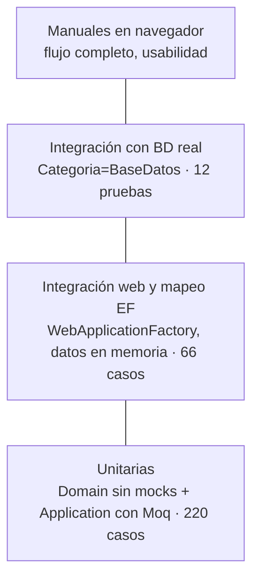

# Plan de pruebas — GalaxyVentas

| | |
|---|---|
| **Dirigido a** | Equipo de desarrollo, responsables de calidad y evaluadores del proyecto |
| **Versión** | 1.0 — 30/10/2026 |
| **Relacionado** | [Requerimientos](requerimientos-funcionales.md) · [Casos de uso](casos-de-uso.md) · [Arquitectura](arquitectura.md) |

## 1. Objetivo

Verificar que GalaxyVentas cumple los requerimientos funcionales (RF-01 a RF-22), las reglas de negocio (RN) y los requerimientos no funcionales de seguridad y compatibilidad con la base de datos existente, y que los datos se graban igual que los procedimientos almacenados de referencia.

## 2. Alcance

**Incluido**

- Reglas de negocio del dominio: importes, IGV por artículo, escalas de tarifa, numeración, invariantes de venta, comprobante y pago.
- Servicios de aplicación y validadores.
- Capa web: sesión, antifalsificación, códigos HTTP y ProblemDetails, vistas.
- Mapeo EF al esquema heredado y grabación completa de una venta contra la BD real.
- Concurrencia de stock y correlativo; reversión ante errores.
- Pruebas manuales de usabilidad en el navegador.

**Excluido**

- Pruebas de carga y rendimiento.
- Compatibilidad con el sistema actual más allá de los valores grabados (no se ejecutan sus procedimientos).
- Funcionalidades fuera de alcance (anulación, notas de crédito, impresión fiscal).

## 3. Estrategia



| Nivel | Proyecto | Qué prueba | Dependencias |
|---|---|---|---|
| **Unitarias de dominio** | `Ventas.UnitTests/Domain` | Cálculos e invariantes de las entidades. | Ninguna (sin mocks ni BD). |
| **Unitarias de aplicación** | `Ventas.UnitTests/Application` | Orquestación de los servicios, validadores, uso de la sesión. | Moq sobre las interfaces. |
| **Integración web** | `Ventas.IntegrationTests/Web` | Host completo con autenticación por cookie, antifalsificación, vistas, JSON y errores. | `AplicacionPrueba`: usuarios y clientes en memoria, maestros con Moq. |
| **Integración de persistencia** | `Ventas.IntegrationTests/Persistence` | Mapeo EF (sin conexión) y consultas y registro contra `BDVenta`. | BD real; las pruebas de registro abren una transacción y la deshacen. |
| **Manuales** | Sección 7 | Flujo de punta a punta en el navegador. | Aplicación en ejecución y datos de prueba. |

Principios:

- Cada servicio nuevo tiene pruebas unitarias (RNF-05).
- Las reglas de negocio se prueban en el dominio, sin mocks.
- Las pruebas contra la BD real **no dejan datos**: usan una transacción que se deshace, salvo la de reversión, que comprueba que el propio servicio deshace todo.
- Si no hay cadena de conexión, las pruebas `Categoria=BaseDatos` terminan sin hacer nada (no fallan).

## 4. Entorno y herramientas

| Elemento | Valor |
|---|---|
| Framework | .NET 10 |
| Pruebas | xUnit, Moq, FluentAssertions, `Microsoft.AspNetCore.Mvc.Testing` |
| Base de datos | SQL Server LocalDB, base `BDVenta`, cadena en User Secrets de `Ventas.Api` |
| Datos previos | `AsignarCategoriasV41.sql` y `CargaStockInicial.sql` ejecutados (artículos de V41/30 con stock) |
| Navegadores (manuales) | Chrome / Edge actualizados; ancho de escritorio y de celular |

### Ejecución

```bash
dotnet test                                            # todo
dotnet test tests/Ventas.UnitTests                     # unitarias
dotnet test tests/Ventas.IntegrationTests              # integración (web + BD)
dotnet test --filter "Categoria=BaseDatos"             # solo contra la BD real
dotnet test --filter "FullyQualifiedName~VentaTests"   # una clase
```

## 5. Criterios de entrada y salida

**Entrada:** la solución compila sin errores; la BD tiene los datos previos de la sección 4.

**Salida (aceptación de una versión):**

- 100 % de pruebas automatizadas en verde, incluidas las de `Categoria=BaseDatos`.
- Casos manuales críticos (M-01 a M-06) aprobados.
- Ningún defecto abierto de severidad alta.

**Suspensión:** si fallan las pruebas de registro contra la BD real, no se aprueba la versión aunque las demás pasen.

## 6. Casos de prueba automatizados

Cada fila corresponde a uno o más métodos de prueba (nombre entre paréntesis). Tipo: **U** unitaria, **W** integración web, **BD** integración con la BD real.

### 6.1 CU-01 / CU-02 — Sesión y seguridad

| ID | Caso | Resultado esperado | Tipo | Prueba |
|---|---|---|---|---|
| P-01 | Credenciales correctas | Cookie segura (`HttpOnly`, `Secure`, `SameSite=Strict`) sin contraseña; redirige a Registrar venta | W | `CuentaTests.IniciarSesion_CredencialesCorrectas_CreaLaCookieSeguraYMuestraElUsuario` |
| P-02 | Usuario inexistente, inactivo o contraseña incorrecta | Mismo mensaje genérico, sin sesión | U, W | `AutenticacionServiceTests.IniciarSesion_UsuarioInexistenteInactivoONoVigente_MismoMensajeGenerico`, `CuentaTests.IniciarSesion_CredencialesIncorrectas_MensajeGenericoSinSesion` |
| P-03 | Contraseña expirada | Indica que expiró | U | `AutenticacionServiceTests.IniciarSesion_ContrasenaExpirada_IndicaQueExpiro` |
| P-04 | Usuario sin punto de venta | Acceso denegado con el motivo | U, W | `AutenticacionServiceTests.IniciarSesion_SinPuntoDeVenta_AccesoDenegado`, `CuentaTests.IniciarSesion_SinPuntoDeVenta_MuestraElMotivo` |
| P-05 | `ReturnUrl` externo | Se ignora (sin redirección abierta) | W | `CuentaTests.IniciarSesion_ConReturnUrlLocal_VuelveALaPaginaPedida` |
| P-06 | Cambia el punto de venta del usuario o se desactiva | La sesión deja de ser válida; AJAX recibe 401 | U, W | `CuentaTests.Sesion_CambiaElPuntoDeVentaDelUsuario_DejaDeSerValida`, `CuentaTests.Sesion_UsuarioDesactivado_LlamadaAjaxRecibe401` |
| P-07 | Página sin sesión / AJAX sin sesión | Redirección al login / 401 con ProblemDetails | W | `SeguridadTests.Pagina_SinSesion_RedirigeAlInicioDeSesion`, `SeguridadTests.LlamadaAjax_SinSesion_Responde401ConProblemDetails` |
| P-08 | POST sin token antifalsificación | 400 sin ejecutar la operación | W | `CuentaTests.IniciarSesion_SinTokenAntifalsificacion_Responde400` y equivalentes en ventas, clientes y Mis datos |
| P-09 | Cerrar sesión | Elimina la sesión | W | `CuentaTests.CerrarSesion_EliminaLaSesion` |
| P-10 | Vigencia del usuario y expiración de la clave | Compara solo fechas | U | `UsuarioTests.*` |

### 6.2 CU-03 — Artículos disponibles

| ID | Caso | Resultado esperado | Tipo | Prueba |
|---|---|---|---|---|
| P-11 | Lista con precio de 1 unidad, stock, categoría e IGV | Ordenada por categoría y descripción | U | `ArticuloServiceTests.ListarDisponibles_CombinaPrecioStockCategoriaEIgvOrdenadosPorCategoria` |
| P-12 | Filtro por texto y por categoría | Pasa el texto sin espacios; categoría 0 o nula no filtra | U | `ArticuloServiceTests.ListarDisponibles_PasaElTextoDeBusquedaSinEspacios`, `..._SinCategoria_NoFiltra` |
| P-13 | Punto de venta o canal inactivo | No encontrado | U | `ArticuloServiceTests.ListarDisponibles_PuntoDeVentaInactivo_NoEncontrado`, `..._CanalInactivo_NoEncontrado` |
| P-14 | Consulta real de V41/30 | Artículos activos con tarifa, categoría activa e IGV entre 0 y 18 % | BD | `ConsultasBaseDatosTests.Articulos_DeLasCategoriasDeV41Canal30ConTarifaEIgvVigentes`, `Articulos_FiltraPorCategoria`, `Articulos_FiltraPorTexto` |
| P-15 | Tasa de IVA vigente | La de vigencia más reciente ≤ fecha; exonerado = 0; ignora inactivos | U | `DetalleIvaTests.*` |
| P-16 | Escala de tarifa | Menor escala que cubre la cantidad; empate → la más reciente; día de caducidad incluido | U | `TarifaTests.*` |

### 6.3 CU-04 / CU-05 — Clientes

| ID | Caso | Resultado esperado | Tipo | Prueba |
|---|---|---|---|---|
| P-17 | Buscar por documento existente / inexistente | Datos del cliente / 404 con ProblemDetails | U, W | `ClienteServiceTests.Buscar_ClienteExistente_DevuelveSusDatos`, `ClientesTests.Buscar_ClienteInexistente_Responde404ConProblemDetails` |
| P-18 | Buscar por nombre en cualquier orden | Encuentra en nombres, apellidos o razón social; máximo 5 palabras | U, W, BD | `ClienteServiceTests.Buscar_TextoConLetras_BuscaPorNombreCadaPalabraUnaVez`, `ClientesTests.Buscar_PorNombre_EncuentraAunqueLasPalabrasEstenEnOtroOrden`, `ConsultasBaseDatosTests.Clientes_BuscaPorNombreEnLasTresColumnas` |
| P-19 | Nombre de menos de 3 caracteres | 400 sin consultar la BD | U, W | `ClienteServiceTests.Buscar_NombreDeMenosDeTresCaracteres_ErrorDeValidacionSinConsultar`, `ClientesTests.Buscar_NombreMuyCorto_Responde400` |
| P-20 | Registrar cliente nuevo | 201 con el código generado | U, W | `ClienteServiceTests.Registrar_ClienteNuevo_LoGuardaYDevuelveSusDatos`, `ClientesTests.Registrar_ClienteNuevo_Responde201` |
| P-21 | Documento ya registrado | 409 sin grabar | U, W | `ClienteServiceTests.Registrar_DocumentoYaRegistrado_ConflictoSinGrabar`, `ClientesTests.Registrar_Duplicado_Responde409` |
| P-22 | Formatos inválidos (DNI ≠ 8, RUC ≠ 11, correo, razón social) | 400 con errores por campo | U, W | `RegistrarClienteValidatorTests.*`, `ClientesTests.Registrar_DatosInvalidos_Responde400ConErroresPorCampo` |
| P-23 | Tipo de persona deducido del documento | DNI → natural; RUC 20 → jurídica; RUC 10 → natural | U | `ClienteTests.*` |

### 6.4 CU-06 a CU-08 — Venta, comprobante y pago

| ID | Caso | Resultado esperado | Tipo | Prueba |
|---|---|---|---|---|
| P-24 | Importes de línea y cabecera | 2 × 59.0000 → subtotal 118, valor 100, IGV 18; totales = Σ líneas | U | `ImportesTests.*`, `VentaTests.AgregarLinea_*` |
| P-25 | Artículo exonerado | IGV 0, valor venta = subtotal | U | `ImportesTests.CalcularLinea_ArticuloExonerado_SinIgv`, `VentaServiceTests.Cotizar_ArticuloExonerado_NoDesglosaIgv` |
| P-26 | Cotización | Precio según escala de la cantidad y totales del dominio | U, W | `VentaServiceTests.Cotizar_PrecioSegunLaEscalaDeLaCantidadYTotalesDelDominio`, `VentasTests.Cotizar_DevuelveLosImportesCalculadosPorElDominio` |
| P-27 | Stock insuficiente / sin tarifa / cantidad sobre la escala | Línea observada y cotización no válida | U | `VentaServiceTests.Cotizar_StockInsuficiente_*`, `..._ArticuloSinTarifa_*`, `..._CantidadMayorQueLaEscalaMasAlta_SinPrecio` |
| P-28 | Validación de la venta | Cliente, tipo, líneas, cantidades enteras, artículo no repetido, banco y operación si no es efectivo | U, W | `VentaValidadoresTests.*`, `VentasTests.RegistrarVenta_DatosInvalidos_Responde400ConErroresPorCampo` |
| P-29 | Registro completo (con mocks) | Venta, comprobante, kardex y pago con los datos de la sesión; 3 `SaveChanges` | U | `RegistroVentaServiceTests.Registrar_ArmaVentaComprobanteKardexYPagoConLosDatosDeLaSesion` |
| P-30 | Sin impresora / sin almacén / cliente inexistente / sin tarifa | Rechazo sin grabar | U | `RegistroVentaServiceTests.Registrar_SinImpresoraParaLaSerie_Rechaza`, `..._PuntoDeVentaSinAlmacen_Rechaza`, `..._ClienteInexistente_NoEncontrado`, `..._ArticuloSinTarifa_Rechaza` |
| P-31 | Comprobante: factura sin RUC, cliente distinto, venta sin líneas | Excepción de dominio | U | `ComprobanteTests.Emitir_*` |
| P-32 | Pago: monto distinto, segundo pago, medio inexistente, falta banco | Excepción de dominio | U | `ComprobanteTests.AsignarPago_*`, `MedioPagoTests.*` |
| P-33 | Serie y número | `B`/`F` + punto de venta; 7 dígitos; correlativo guardado → siguiente | U, W | `TiposComprobanteTests.*`, `ImpresoraTests.*`, `VentasTests.SiguienteNumero_SerieDelPuntoDeVentaDeLaSesion` |
| P-34 | Kardex | Salida con cantidad negativa, fecha sin hora, descripción con serie y número | U | `MovimientoKardexTests.*` |
| P-35 | **Registro real** | Cabecera `' 001'`/`'A'`/`' 30'`/`V41`/liquidación `2`; totales iguales en cabecera, comprobante, líneas y pago; kardex `VENTA` con canal `30`; stock baja exactamente lo vendido; correlativo + 1 | BD | `RegistroVentaBaseDatosTests.Registrar_GrabaVentaComprobanteKardexYPagoConLosValoresDeReferencia` |
| P-36 | **Reversión** | Un fallo tras grabar la cabecera deshace todo | BD | `RegistroVentaBaseDatosTests.Registrar_FallaDespuesDeGrabarLaCabecera_DeshaceTodo` |
| P-37 | **Concurrencia** | Una segunda venta del mismo artículo espera a que termine la primera | BD | `RegistroVentaBaseDatosTests.Bloqueos_UnaSegundaVentaEsperaAQueTermineLaPrimera` |
| P-38 | Stock insuficiente en BD | Excepción de dominio sin grabar | BD | `RegistroVentaBaseDatosTests.Registrar_StockInsuficiente_ExcepcionDeDominioSinGrabar` |

### 6.5 CU-09 / CU-10 — Consultas y reporte

| ID | Caso | Resultado esperado | Tipo | Prueba |
|---|---|---|---|---|
| P-39 | Ver comprobante | Cliente, detalle, totales y pago | U, W | `ConsultaVentasServiceTests.ObtenerComprobante_*`, `ConsultasTests.VerComprobante_MuestraClienteDetalleTotalesYPago` |
| P-40 | Comprobante de otro punto de venta | 403 con el motivo | U, W | `ConsultasTests.VerComprobante_DeOtroPuntoDeVenta_Responde403ConElMotivo` |
| P-41 | Inexistente | 404 / mensaje en la página | U, W | `ConsultasTests.VerComprobante_Inexistente_Responde404`, `ConsultasTests.Consultas_ComprobanteInexistente_MuestraElMensajeEnLaPagina` |
| P-42 | Buscar por transacción o por tipo + número | Redirige al comprobante; número completado a 7 dígitos | U, W | `ConsultaVentasServiceTests.BuscarComprobante_*`, `ConsultasTests.Consultas_PorTransaccion_RedirigeAlComprobante` |
| P-43 | Últimas ventas | Solo del punto de venta de la sesión, máximo 20 | U | `ConsultaVentasServiceTests.ListarRecientes_SoloDelPuntoDeVentaDeLaSesionYConMaximo` |
| P-44 | Reporte: totales y agrupación por medio de pago | Totales = suma de filas | U | `ReporteVentasServiceTests.Generar_TotalesSonLaSumaDeLasFilasYAgrupaPorMedioDePago` |
| P-45 | Reporte: sin ventas, fechas invertidas, rango > 31 días | Vacío con totales en 0 / error de validación | U, W | `ReporteVentasServiceTests.Generar_*`, `ConsultasTests.Reporte_RangoMayorA31Dias_MuestraElError` |

### 6.6 CU-11 / CU-12 — Mis datos

| ID | Caso | Resultado esperado | Tipo | Prueba |
|---|---|---|---|---|
| P-46 | Ver mis datos | Datos de la sesión sin contraseña; opción del menú resaltada | U, W | `MisDatosServiceTests.Obtener_DatosDelUsuarioDeLaSesionSinEspacios`, `MisDatosTests.Index_ConSesion_MuestraLosDatosDelUsuarioYLaOpcionDelMenu` |
| P-47 | Cambio correcto | Mensaje de éxito; la nueva clave sirve para ingresar y la anterior no | U, W | `MisDatosServiceTests.CambiarClave_ClaveActualCorrecta_*`, `MisDatosTests.CambiarClave_Correcta_RedirigeConMensajeYLaNuevaClaveSirveParaIngresar` |
| P-48 | Clave actual incorrecta | Error en el campo; no cambia; las claves no vuelven a la página | U, W | `MisDatosServiceTests.CambiarClave_ClaveActualIncorrecta_*`, `MisDatosTests.CambiarClave_ClaveActualIncorrecta_MuestraElErrorSinDevolverLasClaves` |
| P-49 | Reglas de la nueva clave | 6–16 caracteres, letra y número, sin espacios, distinta, confirmación igual | U | `CambiarClaveValidatorTests.*` |

### 6.7 Transversales

| ID | Caso | Resultado esperado | Tipo | Prueba |
|---|---|---|---|---|
| P-50 | Excepción → código HTTP | 400/401/403/404/409/422/500 según el tipo; 500 sin detalle interno | W | `ManejadorExcepcionesTests.*` |
| P-51 | Mapeo EF | Tablas y columnas reales, incluidas `SGP_CATEGORIA_*` y `SGP_DETALLE_IVA` | W | `MapeoTests.*` |
| P-52 | Catálogos | Solo medios admitidos; ítems activos sin espacios; bancos ordenados | U, BD | `CatalogoServiceTests.*`, `ConsultasBaseDatosTests.Catalogos_MediosDePagoYTiposDeComprobanteActivos` |

## 7. Casos de prueba manuales

Ejecutar con la aplicación en marcha (`dotnet run --project src/Ventas.Api --launch-profile https`) y un usuario de prueba. Registrar el resultado en la columna correspondiente.

| ID | Caso | Pasos | Resultado esperado | Resultado |
|---|---|---|---|---|
| M-01 | Venta en boleta, efectivo, artículos con y sin IGV | Buscar cliente con DNI; agregar un artículo de **Bienes** (18 %) y uno de **Libros** (exonerado); boleta; efectivo; registrar | Comprobante `B…` con IGV solo del artículo de Bienes; aviso «Venta registrada»; el stock baja en ambos | Aprobado: B002-0155332 (trans. 20015), S/ 61.80; IGV 1.83 solo del Bolso, libro 0.00; kardex −1 y −2 |
| M-02 | Venta en factura con tarjeta | Cliente con RUC; factura; tarjeta de crédito con banco y operación | Comprobante `F…` con el pago y el banco | Aprobado: F002-0301231 (trans. 20016), tarjeta de crédito, Banco Continental; exige banco y operación |
| M-03 | Factura a cliente con DNI | Cliente con DNI; factura; registrar | «Para emitir una factura el cliente debe tener RUC.»; no se graba | Aprobado: mensaje mostrado, sin grabar |
| M-04 | Cliente nuevo | Buscar documento inexistente; registrar cliente; vender | Cliente creado y seleccionado | Aprobado: cliente 1231218 creado y seleccionado (no se vendió) |
| M-05 | Stock insuficiente | Cantidad mayor que el stock en el detalle | Línea observada; no permite registrar | Aprobado: «disponible 97, solicitado 500»; bloquea el registro |
| M-06 | Consulta y reporte | Buscar la venta de M-01 por transacción y por número; generar el reporte del día | Comprobante encontrado; la venta aparece en el reporte con sus totales | Aprobado: ambas búsquedas abren la boleta; reporte con 6 comprobantes, sumas verificadas |
| M-07 | Filtro por categoría | Elegir *Libros* en el combo | Solo artículos de Libros, con encabezado de grupo | Aprobado: solo «Libros (10)» |
| M-08 | Cambio de contraseña | Mis datos → cambiar; cerrar sesión; ingresar con la nueva | Ingreso correcto; la anterior es rechazada | Pendiente: las credenciales de prueba fueron rechazadas al volver a ingresar |
| M-09 | Sesión expirada | Borrar la cookie y agregar un artículo | Mensaje de sesión expirada; al recargar, inicio de sesión | Aprobado: la pantalla redirige al inicio de sesión con ReturnUrl |
| M-10 | Pantalla de celular | Repetir M-01 con ancho de 375 px | Menú desplegable; sin desplazamiento horizontal de la página | Aprobado tras corrección: desbordaba a 745 px; corregido en `site.css` (`minmax(0, 1fr)`) |
| M-11 | Impresión | Imprimir comprobante y reporte | Sin menú ni filtros; contenido completo | Aprobado: verificado con las reglas `@media print` (no se abrió el diálogo) |

## 8. Resultados

Última ejecución: **30/10/2026**, rama `main`, con la BD `BDVenta` local y los datos previos de la sección 4.

| Proyecto | Casos ejecutados | Correctos | Fallidos | Omitidos |
|---|---|---|---|---|
| `Ventas.UnitTests` | 220 | 220 | 0 | 0 |
| `Ventas.IntegrationTests` (web + BD) | 78 | 78 | 0 | 0 |
| **Total** | **298** | **298** | **0** | **0** |

Los casos ejecutados cuentan cada combinación de datos de las pruebas parametrizadas (`[Theory]`).

Pruebas manuales: ejecutadas el **30/10/2026** con el usuario `GMD` (punto de venta 002) en Chrome; **10 de 11 aprobadas**, M-08 pendiente (sección 7).

Defectos encontrados y corregidos durante las pruebas manuales:

| Defecto | Severidad | Corrección |
|---|---|---|
| En pantallas de 375 px la página de venta se desplazaba en horizontal (745 px de ancho): la tabla de artículos ensanchaba la columna. | Media | `.grid-venta` usa `minmax(0, 1fr)`; la tabla se desplaza dentro de su tarjeta. |
| En ventanas bajas (≤ 690 px) el botón *Registrar venta* de la columna fija quedaba fuera de la vista. | Media | La columna fija tiene `max-height` y desplazamiento propio. |
| El comprobante mostraba «IGV (18%)» aunque el IGV depende del artículo. | Baja | La etiqueta es «IGV». |

Observaciones sin corregir:

- El resumen y el comprobante rotulan como «Op. gravada» la base imponible, que incluye los importes exonerados (libros); en un comprobante electrónico deberían separarse operación gravada y exonerada.
- La ficha del cliente muestra «Doc.» para el DNI (el comprobante sí dice «DNI»).
- Los avisos de error de la venta no se limpian al corregir los datos, solo al volver a pulsar *Registrar venta*.
- La razón social se corta a 64 caracteres en el comprobante (longitud de la columna heredada).

## 9. Gestión de defectos

| Severidad | Criterio | Ejemplo |
|---|---|---|
| Alta | Datos grabados incorrectamente, venta parcial, acceso a otro punto de venta, exposición de contraseñas. | Totales distintos entre cabecera y comprobante. |
| Media | Funcionalidad no disponible con alternativa. | El filtro por categoría no aplica. |
| Baja | Presentación o textos. | Etiqueta desalineada en el celular. |

Todo defecto corregido debe incluir una prueba automatizada que lo reproduzca.

## 10. Riesgos de las pruebas

| Riesgo | Mitigación |
|---|---|
| Las pruebas de BD dependen de datos previos (categorías y stock). | Los scripts de datos son idempotentes; las pruebas eligen artículos con stock suficiente. |
| La BD de pruebas es compartida con datos reales heredados. | Las pruebas de registro deshacen la transacción; la de reversión verifica que no queden datos. |
| Sin cadena de conexión, las pruebas de BD no se ejecutan y aparecen como correctas. | Ejecutar `dotnet test --filter "Categoria=BaseDatos"` con la cadena configurada antes de aceptar una versión. |
| Las pruebas manuales no están automatizadas. | Ejecutar la lista de la sección 7 en cada versión entregada. |
